# Smart Parking and Digital Queue Management System

## Project Overview

The Smart Parking and Digital Queue Management System is a Java-based application designed to simplify parking management. It allows customers to check parking slot availability, reserve parking spaces, generate queue tokens when parking is unavailable, and track their queue status.

The project uses AWS cloud services to host and manage the application.

## Problem Statement

Finding available parking spaces can be time-consuming. This system helps customers check availability before arriving and join a digital queue when all parking slots are occupied.

## Key Features

- View available and occupied parking slots.
- Reserve available parking spaces.
- Generate digital queue tokens.
- Check queue status.
- Admin can manage parking slots.
- Admin can call the next waiting customer.
- Manage booking and queue records.

## Technologies Used

### Programming and Database
- Java
- MySQL
- HTML
- CSS
- JavaScript

### AWS Cloud Services
- Amazon EC2 – Application hosting
- Amazon RDS – MySQL database
- Amazon S3 – Static website hosting
- Application Load Balancer – Traffic distribution
- Amazon CloudFront – Content delivery
- Amazon Route 53 – Domain management
- AWS WAF – Web application protection
- AWS Lambda – Automated data cleanup
- Amazon EventBridge – Scheduled execution

## AWS Architecture

The project follows a three-tier cloud architecture.

**Tier 1 – Presentation Layer**
- Amazon S3
- CloudFront
- Route 53
- AWS WAF

**Tier 2 – Application Layer**
- Application Load Balancer
- Amazon EC2
- Java Backend

**Tier 3 – Database Layer**
- Amazon RDS
- MySQL Database

**Automation**
- AWS Lambda
- Amazon EventBridge

## Application Workflow

1. Customer opens the parking application.
2. Customer checks parking slot availability.
3. If a slot is available, the customer can reserve it.
4. If all slots are occupied, the customer can join the digital queue.
5. The system generates a queue token.
6. Customer checks queue status.
7. Admin calls the next waiting customer and manages bookings.

## Project Deployment

The Java backend application is hosted on Amazon EC2 and connects to an Amazon RDS MySQL database.

An Application Load Balancer distributes incoming application traffic to the backend.

Static customer-facing files are hosted on Amazon S3 and delivered through CloudFront.

## Learning Outcomes

- Hands-on experience with AWS cloud services.
- Java application deployment on Amazon EC2.
- MySQL database integration with Amazon RDS.
- Application Load Balancer configuration.
- Static website hosting using Amazon S3.
- Cloud architecture design and deployment.

## GitHub Repository

https://github.com/jegalinjasmi-jega/smart-parking-digital-queue-management-system

## Author

**Jegalin Jasmi**

B.E. Electrical and Electronics Engineering

GitHub: https://github.com/jegalinjasmi-jega

## Project Screenshots

### 1. AWS Architecture
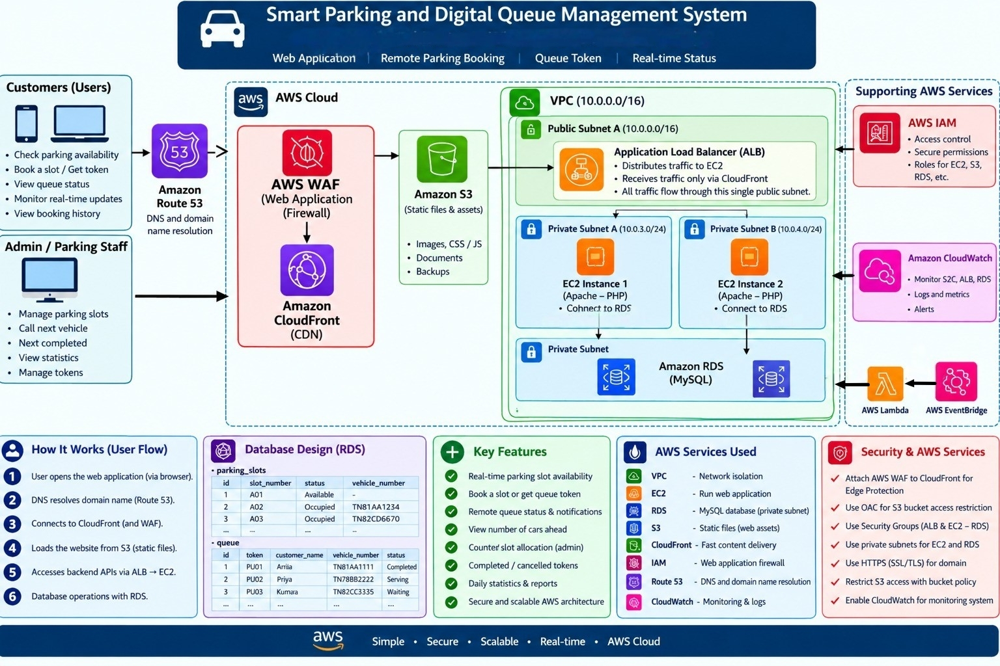

### 2. AWS Architecture Flowchart
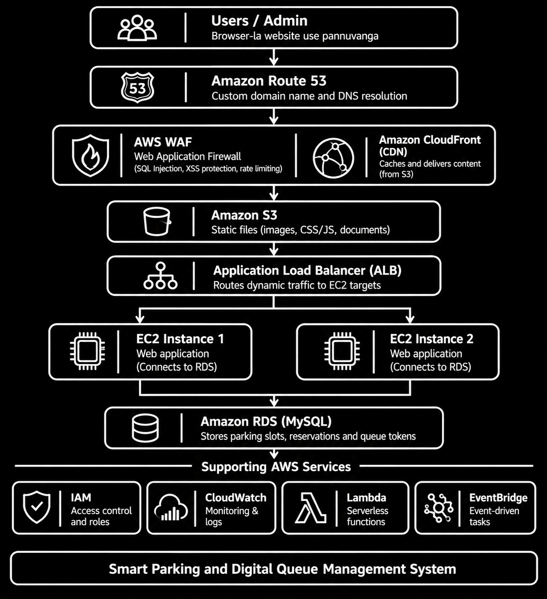

### 3. WAF and CloudFront
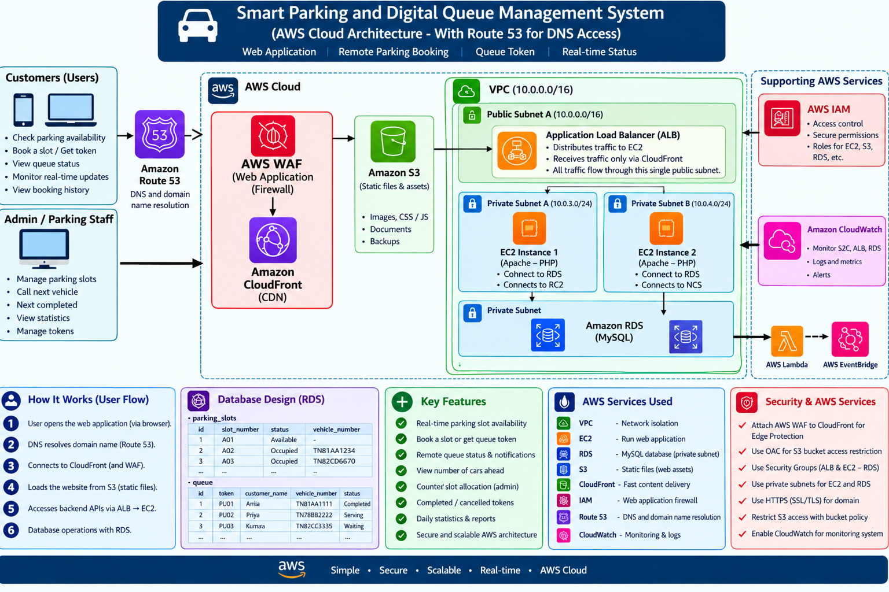

### 4. VPC
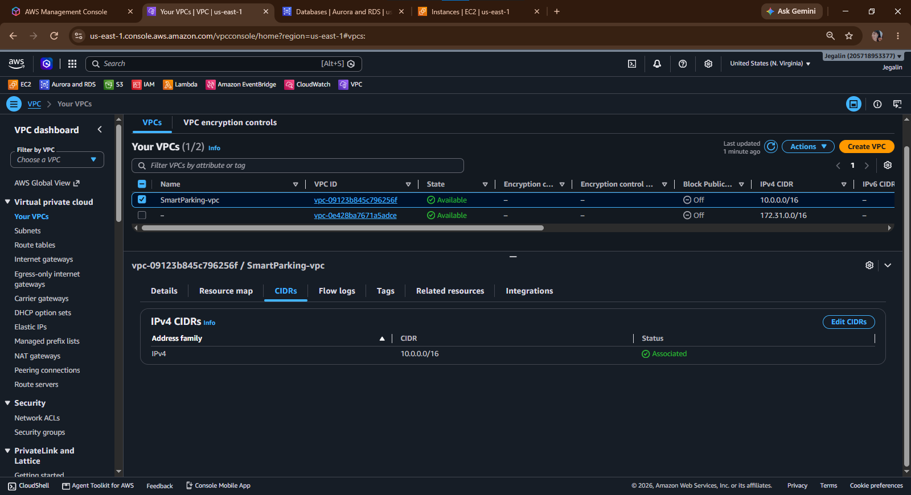

### 5. Subnets
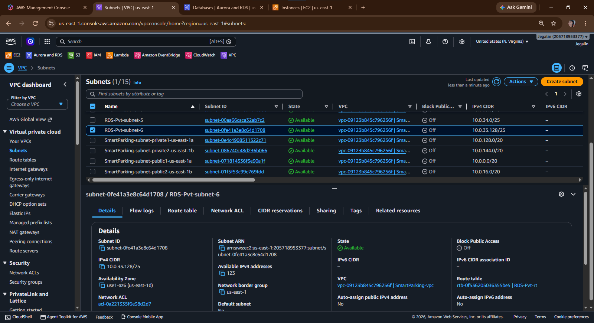

### 6. EC2 Instances
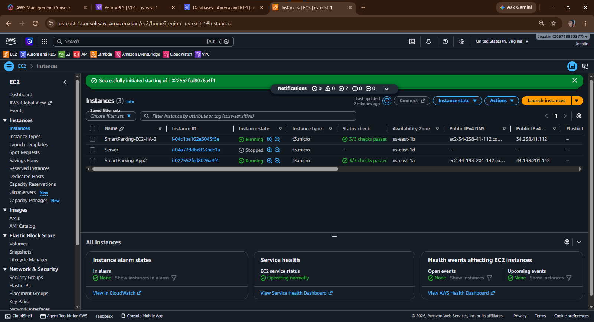

### 7. Application Load Balancer
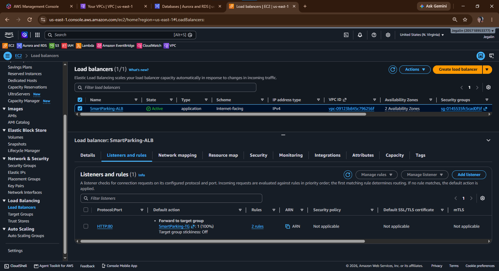

### 8. Target Group Health
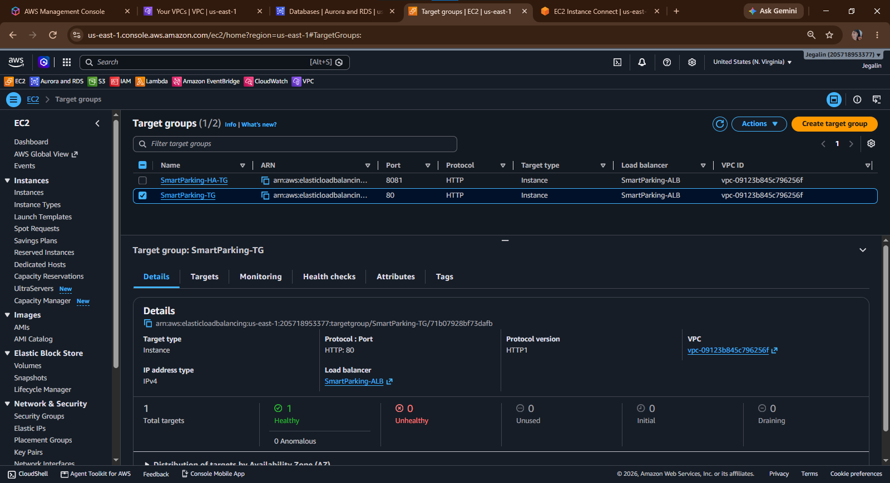

### 9. RDS MySQL
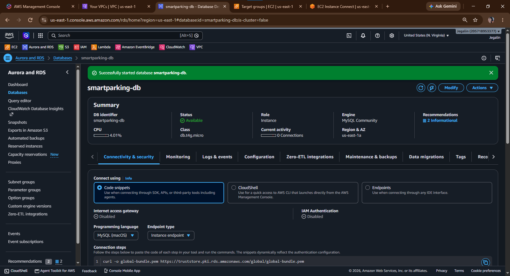

### 10. Amazon S3
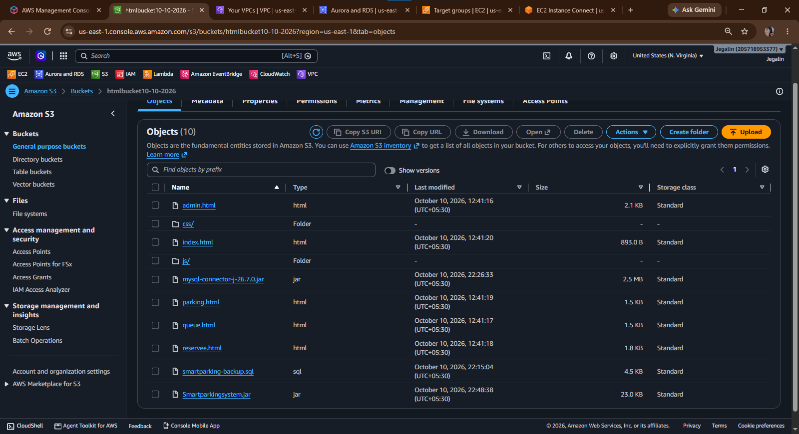

### 11. Website Home
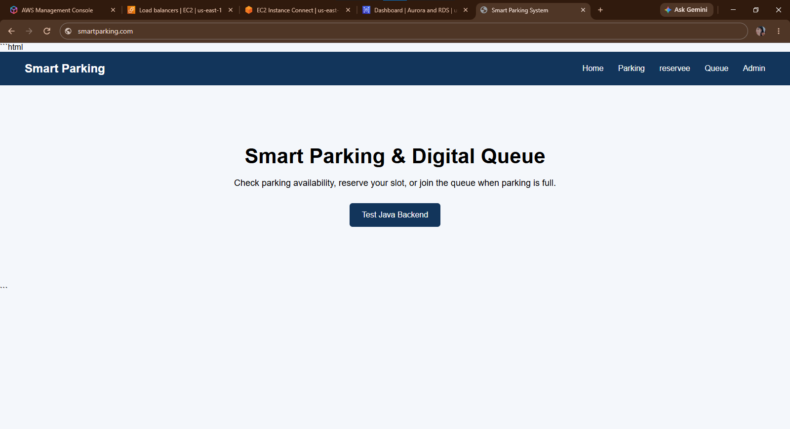

### 12. Parking Availability
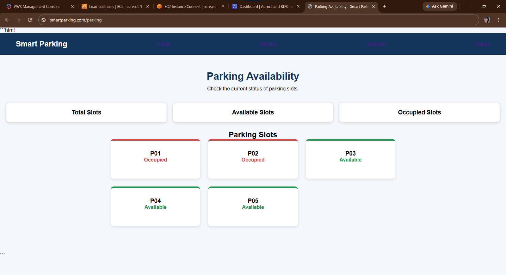

### 13. Reserve Parking
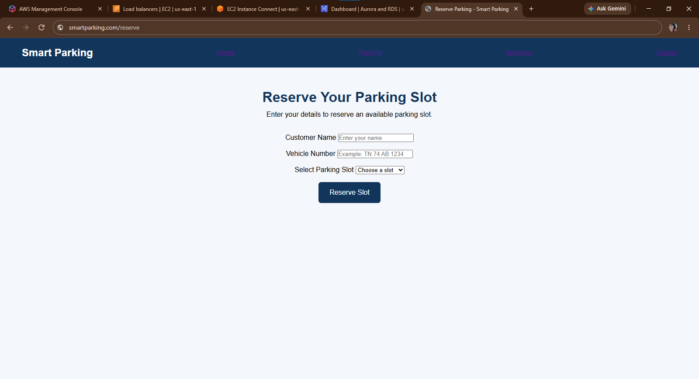

### 14. Digital Queue
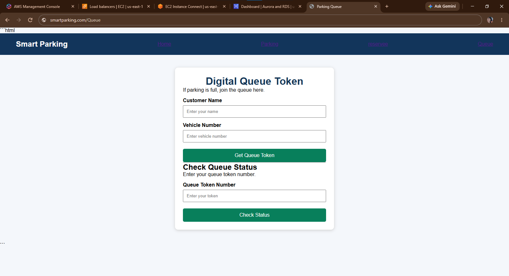

### 15. Admin Dashboard
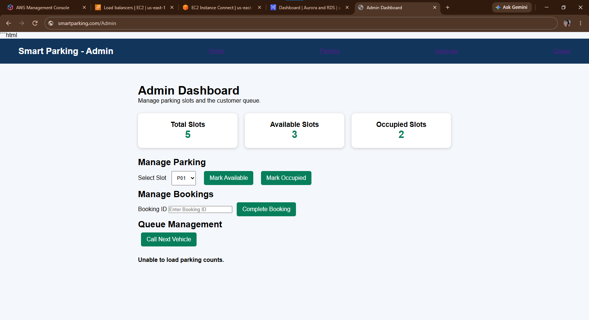

### 16. Java Backend
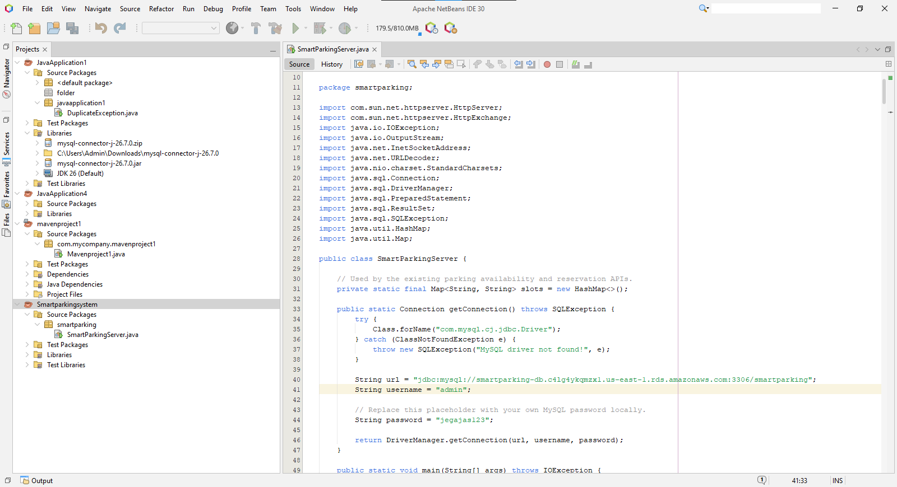

### 17. Smart Parking Database
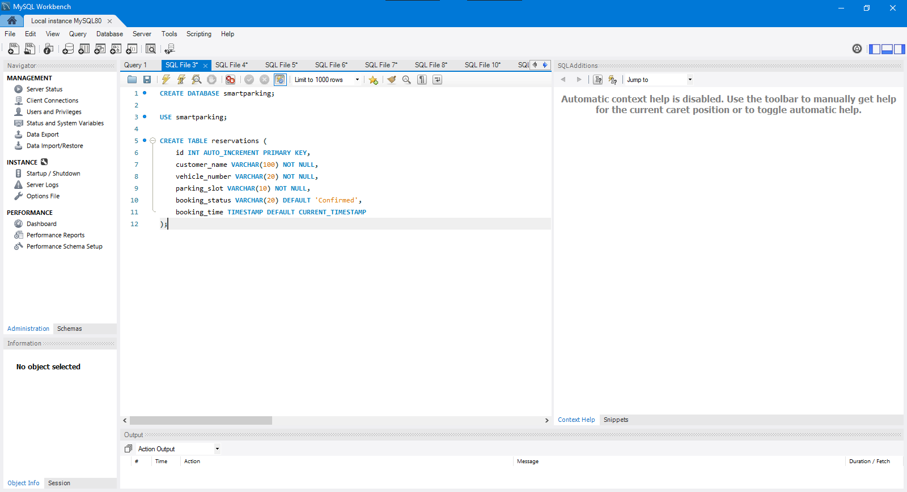
